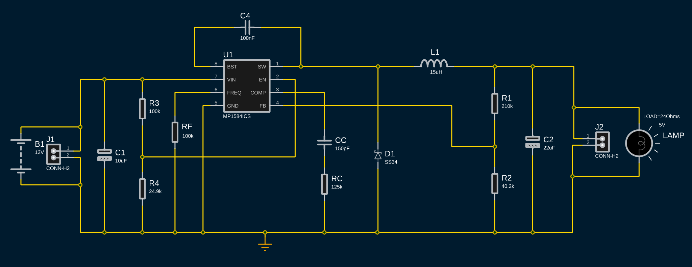

This document analyzes a switch-mode step-down converter using the **MP1584** high-frequency buck regulator.

## 1. Circuit Overview

The MP1584 circuit converts a higher DC input voltage into a lower, regulated output voltage. The example circuit is designed for:

- Input voltage: 12 V DC
- Target output voltage: 5 V DC
- Maximum output current: approximately 3 A
- Switching frequency: adjustable up to 1.5 MHz

### Main Components

- **U1 — MP1584:** Monolithic high-frequency buck switching regulator with internal power MOSFETs.
- **B1 — Input source:** Provides the 12 V DC input.
- **C1 — Input capacitor:** Suppresses input switching ripple and stabilizes the input supply.
- **L1 — Output inductor:** Stores energy while the high-side switch is conducting and transfers energy to the output while the switch is off.
- **C2 — Output capacitor:** Smooths the output voltage and reduces ripple.
- **D1 — SS34 Schottky diode:** Provides a freewheeling path for the inductor current when the internal switch turns off.
- **R1 and R2:** Feedback divider that determines the regulated output voltage.
- **R3 and R4:** Enable-pin divider used for undervoltage lockout and startup sequencing.
- **RF, RC, and CC:** Frequency-setting and compensation components that affect switching behavior and control-loop stability.
- **L2 — Load:** 24 Ω output load used for the nominal operating test.

### MP1584 Schematic Diagram



## 2. Operating Principle

### 1. Switch-on interval

When the internal high-side switch turns on, current flows from the input source through the output inductor L1 and into the output. The inductor current rises, storing energy in its magnetic field.

### 2. Switch-off interval

When the switch turns off, the inductor maintains current flow. It discharges through the catch diode D1, output capacitor C2, and load.

### 3. Closed-loop regulation

The feedback pin measures a portion of the output voltage through the R1/R2 divider. The internal error amplifier adjusts the PWM duty cycle to maintain the regulated output voltage when the input voltage or load changes.

## 3. Graphical Analysis

### DC output waveform

The output voltage waveform should settle near 5 V after the startup transient. Startup time depends on the soft-start implementation, feedback divider, compensation components, output capacitance, and load.


### Switching-node waveform

The switching node toggles between approximately 0 V and 12 V. The precise transition shape depends on parasitic inductance, capacitance, diode recovery, MOSFET switching speed, and PCB layout.


### Fourier analysis

The Fourier spectrum of the switching node contains energy at the fundamental switching frequency and its harmonics. A switching regulator therefore requires a suitably designed output filter and PCB layout to control ripple and electromagnetic interference.


### PWM Switching Frequency

The MP1584 switching frequency is set by the resistor **RF** connected from the FREQ pin to ground. In this circuit, RF is **100 kΩ**, giving an estimated switching frequency of approximately **1.1 MHz**. The frequency can be estimated using the following relationship:

**fSW (Hz) ≈ 1.1 × 1011 RF (Ω)**

Substituting RF = 100 kΩ:

**fSW ≈ (1.1 × 1011) / (100 × 103) = 1.1 × 106 Hz = 1.1 MHz**

This is a nominal estimate; the actual switching frequency can vary with device and component tolerances. Also, the behavioral SPICE model may not reproduce the datasheet frequency exactly unless its oscillator is calibrated, so verify the simulated switching-node waveform or measure the hardware.

## 4. MP1584 SPICE Model

This document uses a behavioral MP1584 SPICE subcircuit for circuit simulation. Its characteristics include:

- 8-pin MP1584 pin-order mapping
- Behavioral oscillator
- Error amplifier
- Soft-start ramp
- Peak-current comparator
- Enable and undervoltage-lockout logic
- High-side switch model
- Bootstrap charging behavior
- Thermal shutdown: **not modeled**
- Full production tolerances: **not modeled**

MP1584 Spice Code

```
* ============================================================================
* MP1584 Spice Model
* Direct Current Source Model
* Version : 1.2
* Author  : ee-diary.net
* Date    : 2026-11-26
*
* Change log
*   1.0  Original behavioural model
*   1.2  2026-11-26  Faster COMP start-up: EA current limit x10 (gm and DC gain unchanged),
*                    COMP clamped by a current source (-0.9 V .. 1.42 V)
*   1.1  2026-11-26  Error amp converted to a direct current source (Norton form of
*                    the old BEA voltage source + REA 3.33MEG); soft-start ramp
*                    shortened 1.5 ms -> 150U for quick simulations (see SOFT-START note)
*
* SOFT-START note: the ramp time is the PULSE rise time of V1 below.
*   1.5M = 1.5 ms (original, realistic), 150U = 0.15 ms (quick simulation).
* Pin order = package pin order:  
* 1 SW, 2 EN, 3 COMP, 4 FB, 5 GND, 6 FREQ, 7 VIN, 8 BST
* ============================================================================
.SUBCKT MP1584 SW EN COMP FB GND FREQ VIN BST

* ---------------- Oscillator: ramp current = 8.5 * (1V / RFREQ) -----------
VBIAS  NBIAS GND DC 0 PULSE(0 1 10N 10N 1M 10 20)
VSENS  NBIAS FREQ DC 0
F1     GND SAW VSENS 8.5
CSAW   SAW GND 100P
RSAW   SAW GND 1G
S1     SAW GND SAW GND SWRST
* clock: CLK is pulled to 5 V through 200 ohm while the ramp is low
S2     CLK V5CLK SAW GND SWCLK
V10    V5CLK GND DC 5
RCLK   CLK GND 10K

* ---------------- Soft start + error amplifier (gm = 200/3.33MEG) ---------
V1     NSS GND DC 0 PULSE(0 0.8 0 150U 150U 10 20)
* Error amp: gm = 60 uS (same as original), output limit +/-4.3 uA (10x the original +/-0.43 uA)
* so COMP charges 10x faster during start-up; DC gain 200 and COMP range unchanged
BEA    GND COMP I=0.5*(abs(60E-6*(V(NSS,GND)-V(FB,GND))+4.3E-6)-abs(60E-6*(V(NSS,GND)-V(FB,GND))-4.3E-6))
* COMP voltage limits -0.9 V ... 1.42 V (same as the original EA output range)
BCLMP  COMP GND I=(V(COMP,GND)-0.5*(abs(V(COMP,GND)+0.9)-abs(V(COMP,GND)-1.42)+0.52))/10
REA    COMP GND 3.33MEG

* ---------------- Current sense (R_SENSE 25 mohm, gain 4.44) --------------
RSENSE VIN DRN 25M
BISNS  ISO GND V=0.5*(abs(4.44*(V(VIN,GND)-V(DRN,GND)))-abs(4.44*(V(VIN,GND)-V(DRN,GND))-5)+5)
RISO   ISO NBLK 100
RBLANK NBLK NSNS 1K
CBLANK NSNS GND 100P

* ---------------- Slope compensation: 0.85 V + 0.5 * ramp ----------------
EAVS   NSL NOFF SAW GND 0.5
V3     NOFF GND DC 0.85
BSUM1  NSUM GND V=V(NSNS,GND)+V(NSL,GND)

* ---------------- Peak-current comparator (gain 1E3, 0..5 V) --------------
BPEAK  NPK GND V=0.5*(abs(1E3*(V(NSUM,GND)-V(COMP,GND)))-abs(1E3*(V(NSUM,GND)-V(COMP,GND))-5)+5)

* ---------------- SR latch: two cross-coupled NOR gates -------------------
*   NQ  = NOR(NPK , NQB)     (U3, SR_LATCH_A)
*   NQB = NOR(NQ  , CLK)     (U4, SR_LATCH_B)
BU3    NQR GND V=5*(0.5-0.5*(abs(4*(V(NPK,GND)-2.5)+0.5)-abs(4*(V(NPK,GND)-2.5)-0.5)))*(0.5-0.5*(abs(4*(V(NQB,GND)-2.5)+0.5)-abs(4*(V(NQB,GND)-2.5)-0.5)))
RU3    NQR NQ 1K
CU3    NQ GND 8.7P
BU4    NQBR GND V=5*(0.5-0.5*(abs(4*(V(NQ,GND)-2.5)+0.5)-abs(4*(V(NQ,GND)-2.5)-0.5)))*(0.5-0.5*(abs(4*(V(CLK,GND)-2.5)+0.5)-abs(4*(V(CLK,GND)-2.5)-0.5)))
RU4    NQBR NQB 1K
CU4    NQB GND 8.7P
* U5 now a non-inverting buffer: NQ high = switch ON (set by CLK, reset by TRIP)
BU5    NON GND V=5*(0.5+0.5*(abs(4*(V(NQ,GND)-2.5)+0.5)-abs(4*(V(NQ,GND)-2.5)-0.5)))

* ---------------- Enable / UVLO ------------------------------------------
R1EN   EN NENP 3MEG
V8     NENP GND DC 3
V6     NUVT GND DC 3
V7     NENT GND DC 1.35
BUVLO  NUV GND V=0.5*(abs(100*(V(VIN,GND)-V(NUVT,GND)))-abs(100*(V(VIN,GND)-V(NUVT,GND))-5)+5)
BENC   NEN GND V=0.5*(abs(100*(V(EN,GND)-V(NENT,GND)))-abs(100*(V(EN,GND)-V(NENT,GND))-5)+5)
* U10 EN_UVLO_AND
BU10   NEUR GND V=5*(0.5+0.5*(abs(4*(V(NUV,GND)-2.5)+0.5)-abs(4*(V(NUV,GND)-2.5)-0.5)))*(0.5+0.5*(abs(4*(V(NEN,GND)-2.5)+0.5)-abs(4*(V(NEN,GND)-2.5)-0.5)))
RU10   NEUR NEU 1K
CU10   NEU GND 7P
* U11 DRIVE_ENABLE_AND
BU11   NDER GND V=5*(0.5+0.5*(abs(4*(V(NEU,GND)-2.5)+0.5)-abs(4*(V(NEU,GND)-2.5)-0.5)))*(0.5+0.5*(abs(4*(V(NON,GND)-2.5)+0.5)-abs(4*(V(NON,GND)-2.5)-0.5)))
RU11   NDER NDRV 1K
CU11   NDRV GND 7P

* ---------------- High-side switch and gate drive -------------------------
BSUM2  NDRS GND V=V(NDRV,GND)+V(SW,GND)
RG     NDRS NGATE 50
RPD    NGATE SW 100K
M1     DRN NGATE SW SW NMOSFET
C1     SW GND 100P

* ---------------- Bootstrap supply: floating 5 V source riding on SW -------
* No voltage source / diode: BST is charged by a current source toward SW+5 V
* (ideal diode + 5 ohm, written with abs()). SW+5 is computed, not a circuit node.
BCHG   GND BST I=0.5*((V(SW,GND)+5-V(BST,GND))+abs(V(SW,GND)+5-V(BST,GND)))/5
RBST   BST GND 100MEG

* ---------------- Models --------------------------------------------------
.MODEL SWRST SW(VT=0.55 VH=0.45 RON=200 ROFF=1G)
.MODEL SWCLK SW(VT=0.55 VH=0.45 RON=200 ROFF=1G)
.MODEL NMOSFET NMOS(VTO=2 KP=2.2 RD=0.02)
.MODEL DIODE D(IS=2.52N RS=0.1 CJO=4P N=1.75 M=0.4)

.ENDS MP1584
```

**Simulation note:** The model is intended for functional and educational analysis. It is not a replacement for the manufacturer’s qualified device model or hardware validation.

### Pin Mapping


| Subcircuit pin | MP1584 pin | Function |
| -------------- | ---------- | ----------------- |
| SW | 1 | Switching node |
| EN | 2 | Enable input |
| COMP | 3 | Compensation node |
| FB | 4 | Feedback input |
| GND | 5 | Ground |
| FREQ | 6 | Frequency setting |
| VIN | 7 | Input supply |
| BST | 8 | Bootstrap supply |


## 5. Test-Circuit Configuration

- Input voltage: 12 V
- Target output voltage: 5 V
- Typical switching frequency: 100 kHz to 1.5 MHz, depending on RF
- Load: 24 Ω resistive load
- Output-capacitor ripple must be verified using the selected ESR
- PCB layout and loop-area routing should follow the MP1584 datasheet

### MP1584 Test Circuit Schematic


Before constructing the converter:

1. Verify the feedback-divider ratio.
2. Confirm that RF produces an acceptable switching frequency.
3. Verify the inductor saturation-current and RMS-current ratings.
4. Check the input and output capacitor voltage and ripple-current ratings.
5. Confirm that the diode and PCB copper can handle the required current.
6. Measure the switching node, feedback node, and output with suitable probes.

## 6. Downloadable Files

- [MP1584 SPICE model](https://github.com/ee-diary/ee-diary.github.io/blob/main/assets/download/models/spice/MP1584IC.LIB)

## 7. Performance Summary


| Parameter | Specification |
| ---------------------- | ----------------------------------------------------------- |
| Input voltage range | 4.5 V to 28 V |
| Nominal input voltage | 12 V |
| Output voltage | 5 V, adjustable through the feedback divider |
| Maximum output current | Up to 3 A |
| Switching frequency | Up to 1.5 MHz |
| Typical efficiency | 80% to 90%, depending on load and component selection |
| Protection features | Over-current protection and thermal shutdown on the real IC |


